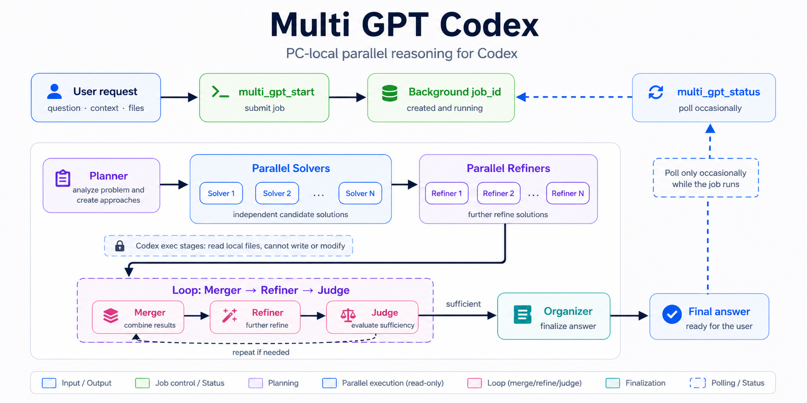

# Multi GPT Codex

Multi GPT is a Codex Skill plus MCP server for local parallel reasoning. It starts an async background job that runs multiple read-only `codex exec` stages, compares independent approaches, refines them, judges sufficiency, and returns a concise final answer.

Inspired by GPT Pro, Gemini DeepThink, and Grok MultiAgents; implemented as a local Codex parallel-reasoning MCP + Skill.



## Requirements

- Codex CLI available on `PATH`
- Node.js available on `PATH`
- A Codex environment that can register local MCP servers

## What it does

- Starts long-running reasoning jobs through `multi_gpt_start`.
- Retrieves job state and final output through `multi_gpt_status`.
- Cancels mistakenly started running jobs through `multi_gpt_cancel`.
- Uses a Planner -> parallel Solvers -> parallel Refiners -> Loop(Merger -> Refiner -> Judge) -> Organizer pipeline.
- Keeps each Codex stage read-only with no approval prompts.
- Lets Codex CLI use its configured or recommended default model unless you pass a `model` argument.

Use it for complex design comparisons, deep code or architecture review, and long-form problem solving that benefits from several independent approaches. Do not use it for ordinary short answers.

## Repository layout

```text
skills/multi-gpt/
  SKILL.md
  agents/openai.yaml
mcp_servers/multi-gpt/
  server.mjs
```

Runtime job files are written under `$CODEX_HOME/mcp_servers/multi-gpt/jobs/` and are intentionally ignored by git.

## Install

The recommended path is to install the skill with Codex's `skill-installer`, then register the MCP server.

```sh
# In Codex, ask:
Install the multi-gpt skill from https://github.com/hehee9/multi-gpt/tree/main/skills/multi-gpt
```

Then clone the repository so the MCP server has a stable local path:

```sh
git clone https://github.com/hehee9/multi-gpt.git
cd multi-gpt
```

If you prefer manual installation, copy the skill into Codex:

```sh
mkdir -p "$CODEX_HOME/skills"
cp -R skills/multi-gpt "$CODEX_HOME/skills/multi-gpt"
```

If `CODEX_HOME` is not set, use `~/.codex`:

```sh
mkdir -p ~/.codex/skills
cp -R skills/multi-gpt ~/.codex/skills/multi-gpt
```

Register the MCP server with Codex CLI.

On macOS/Linux:

```sh
codex mcp add multi_gpt -- node "$(pwd)/mcp_servers/multi-gpt/server.mjs"
```

On Windows PowerShell:

```powershell
codex mcp add multi_gpt -- node "$PWD\mcp_servers\multi-gpt\server.mjs"
```

If you are updating an existing registration, remove it first with `codex mcp remove multi_gpt`, then run the `codex mcp add` command again.

Restart Codex after installing or updating the skill so it reloads skill metadata and MCP tools.

## Usage

Ask Codex for Multi GPT or a parallel-reasoning review of a complex task. Codex should call:

1. `multi_gpt_start` with:
   - `prompt` (required)
   - `files` (optional absolute file paths)
   - `model` (optional; omitted means Codex CLI default or recommended model)
   - `reasoning_effort` (`none`, `low`, `medium`, `high`, or `xhigh`)
   - `max_iterations` (optional; default `5`, clamped to `1..10`)
2. `multi_gpt_status` with the returned `job_id`.
3. `multi_gpt_cancel` with the returned `job_id` if the job was started by mistake.

Runs usually take 5-20 minutes and commonly finish around 10-15 minutes, so poll only occasionally unless tighter monitoring is necessary.

`multi_gpt_status` returns `status: completed`, `failed`, `running`, or `canceled`. Treat `canceled` as a terminal state. Cancelation targets jobs owned by the current MCP server process; after a server restart, stale job files can still be inspected but their former child processes cannot be targeted reliably.

## Contact

gyugyum@gmail.com

## License

Released under the MIT License. See [LICENSE](LICENSE) for details.
