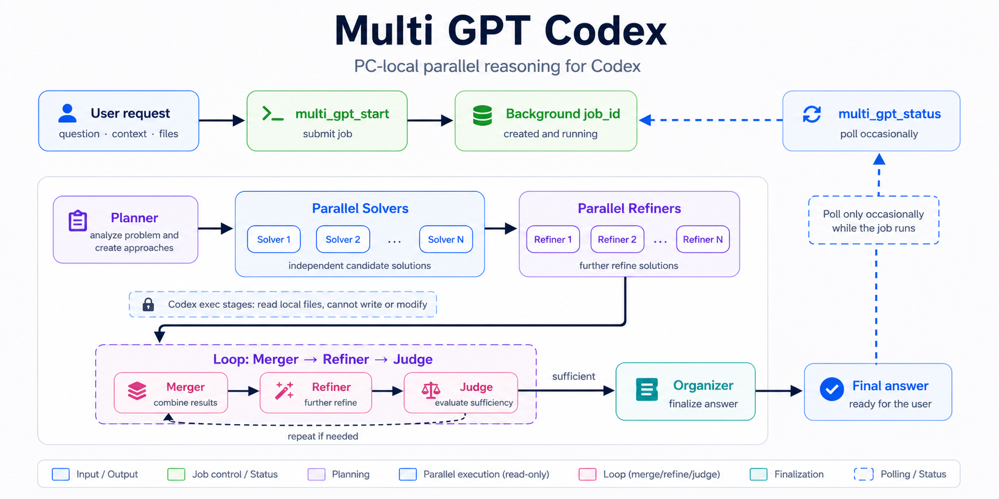

# Multi GPT Codex

Multi GPT는 Codex용 스킬과 MCP 서버를 함께 제공하는 로컬 병렬 추론 도구입니다. 비동기 백그라운드 작업을 시작해 여러 개의 읽기 전용 `codex exec` 단계를 실행하고, 서로 다른 접근법을 비교·개선·판정한 뒤 간결한 최종 답변을 돌려줍니다.

GPT Pro, Gemini DeepThink, Grok MultiAgents에서 아이디어를 얻었고, Codex에서 로컬로 실행되는 병렬 추론 MCP + 스킬 형태로 구현했습니다.



## 요구 사항

- `PATH`에서 실행 가능한 Codex CLI
- `PATH`에서 실행 가능한 Node.js
- 로컬 MCP 서버를 등록할 수 있는 Codex 환경

## 주요 기능

- `multi_gpt_start`로 오래 걸리는 추론 작업을 백그라운드에서 시작합니다.
- `multi_gpt_status`로 작업 상태와 최종 결과를 가져옵니다.
- 잘못 시작한 실행 중 작업은 `multi_gpt_cancel`로 취소합니다.
- Planner -> 병렬 Solvers -> 병렬 Refiners -> Loop(Merger -> Refiner -> Judge) -> Organizer 흐름으로 동작합니다.
- 각 Codex 단계는 읽기 전용 샌드박스에서 승인 요청 없이 실행됩니다.
- `model` 인자를 넘기지 않으면 Codex CLI에 설정된 기본 모델이나 권장 기본 모델을 사용합니다.

복잡한 설계 비교, 깊은 코드·아키텍처 리뷰, 여러 독립 접근법을 비교해야 하는 긴 문제 해결에 적합합니다. 짧은 단발 질문에는 일반 Codex 답변이나 Codex 서브 에이전트를 쓰는 편이 좋습니다.

## 저장소 구조

```text
skills/multi-gpt/
  SKILL.md
  agents/openai.yaml
mcp_servers/multi-gpt/
  server.mjs
```

실행 중 생기는 작업 파일은 `$CODEX_HOME/mcp_servers/multi-gpt/jobs/` 아래에 저장되며, git에는 포함하지 않습니다.

## 설치

권장 설치 방법은 Codex의 `skill-installer`로 스킬을 설치한 뒤, MCP 서버를 등록하는 방식입니다.

```sh
# Codex에서 이렇게 요청하세요:
Install the multi-gpt skill from https://github.com/hehee9/multi-gpt/tree/main/skills/multi-gpt
```

그다음 MCP 서버가 안정적인 로컬 경로에서 실행될 수 있도록 저장소를 복제합니다.

```sh
git clone https://github.com/hehee9/multi-gpt.git
cd multi-gpt
```

수동 설치를 원한다면 스킬을 Codex 스킬 폴더로 직접 복사해도 됩니다.

```sh
mkdir -p "$CODEX_HOME/skills"
cp -R skills/multi-gpt "$CODEX_HOME/skills/multi-gpt"
```

`CODEX_HOME`을 쓰지 않는 환경에서는 `~/.codex`를 사용하면 됩니다.

```sh
mkdir -p ~/.codex/skills
cp -R skills/multi-gpt ~/.codex/skills/multi-gpt
```

이어서 Codex CLI로 MCP 서버를 등록합니다.

macOS/Linux:

```sh
codex mcp add multi_gpt -- node "$(pwd)/mcp_servers/multi-gpt/server.mjs"
```

Windows PowerShell:

```powershell
codex mcp add multi_gpt -- node "$PWD\mcp_servers\multi-gpt\server.mjs"
```

이미 같은 이름으로 등록되어 있다면 `codex mcp remove multi_gpt`로 기존 등록을 지운 뒤, `codex mcp add` 명령을 다시 실행하세요.

설치나 업데이트 후에는 Codex를 다시 시작해야 스킬 메타데이터와 MCP 도구가 다시 로드됩니다.

## 사용법

Codex에게 Multi GPT나 병렬 추론 리뷰를 요청하면, 복잡한 작업에 대해 다음 도구를 사용합니다.

1. `multi_gpt_start`
   - `prompt`: 필수
   - `files`: 선택, 컨텍스트로 읽을 절대 파일 경로 목록
   - `model`: 선택, 생략하면 Codex CLI 기본 모델 또는 권장 기본 모델 사용
   - `reasoning_effort`: `none`, `low`, `medium`, `high`, `xhigh`
   - `max_iterations`: 선택, 기본값 `5`, 실제 범위는 `1..10`
2. `multi_gpt_status`
   - `multi_gpt_start`가 반환한 `job_id`를 넘겨 작업 상태와 최종 결과를 확인합니다.
3. `multi_gpt_cancel`
   - 잘못 시작한 실행 중 작업의 `job_id`를 넘겨 취소합니다.

일반적인 실행 시간은 5~20분이고, 보통 10~15분 안에 끝납니다. 특별히 촘촘한 모니터링이 필요한 상황에서만 더 자주 확인하세요.

`multi_gpt_status`는 `completed`, `failed`, `running`, `canceled` 상태를 반환합니다. `canceled`는 더 이상 폴링하지 않아도 되는 최종 상태입니다. 취소는 현재 MCP 서버 프로세스가 소유한 실행 중 작업을 대상으로 하며, 서버 재시작 뒤 남아 있는 작업 파일은 상태 확인만 안정적으로 가능합니다.

## 연락처

gyugyum@gmail.com

## 라이선스

MIT 라이선스로 배포됩니다. 자세한 내용은 [LICENSE](LICENSE)를 참고하세요.
